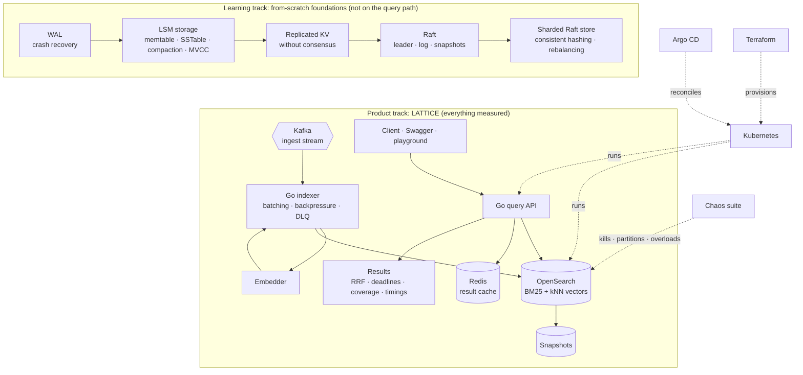

# LATTICE — Explicit Coverage in Deadline-Bounded Distributed Search

[](https://github.com/nickemma/lattice/actions/workflows/ci.yml)


**A hybrid search platform whose responses declare their own coverage. When shards fail to answer, LATTICE still returns results inside the deadline — and says exactly what is missing and why.**

[Findings](#findings) · [Project status](#project-status) · [Architecture](#architecture) · [Quick start](#quick-start) · [Benchmarks](docs/benchmarks.md) · [Experiments](docs/experiments/README.md)

---

## The question

Distributed search engines routinely return partial results when shards time out or drop out of rotation, and rarely say so. A caller cannot tell a thin result set from an incomplete one, and cannot tell a dead shard from a slow one.

LATTICE asks what it takes to make that silence impossible: every response carries a coverage record answering two independent questions — *did every shard answer?* (`complete`) and *did anything fail?* (`degraded`) — plus a `reason` from a closed set. The same `complete: false` can mean a shard left rotation (`shard_unavailable`) or the deadline expired (`deadline`): the same symptom, a different event, a different fix.

```json
"coverage": {
  "shards_queried": 6,
  "shards_answered": 5,
  "complete": false,
  "degraded": false,
  "reason": "shard_unavailable"
}
```

The four `complete` / `degraded` combinations and the full `reason` enum are in [`api.md`](api.md#coverage).

---

## Findings

**1. Explicit coverage separates the two kinds of incompleteness on a real cluster.** With one data node of a three-node OpenSearch cluster stopped, 5,000 of 5,000 responses were marked incomplete with `reason: "shard_unavailable"`, zero errors and zero degraded responses; the cluster returned to baseline after recovery. Of nine load configurations, one isolated the shard fault cleanly, three were compound (deadline expiries alongside the shard fault, accounted for exactly), and five were excluded as saturated. Reproduce with `make experiment-partial-opensearch`; raw reports in [`docs/experiments/`](docs/experiments/README.md).

**2. Segment count and tail latency — an observation under test.** Three incidental full-corpus runs (n = 1 each) showed p99 falling from 191.85 ms at 59 primary segments to 49.06 ms at 3, while p50 moved by about 1 ms. Those runs repeated one query with the Redis result cache enabled, before cache hits were recorded, so they cannot attribute the tail to segment count. `make experiment-segments` is the designed test: controlled segment counts read back from the `_segments` API, three query classes, repeated runs, merge cost per point, and the result cache disabled. Until it has run, this is an observation, not a measured relationship.

---

## Project status

**Complete.** Scope is closed; no new phases are planned.

| Evidence | Result |
|---|---|
| Corpus | 1,000,008 documents indexed and searchable |
| Query latency at rest | 16.66 ms p50, 191.85 ms p99 at 1,514 QPS (concurrency 32, 200 ms deadline) |
| Query latency during concurrent indexing | 24.69 ms p50, 95.55 ms p99 at 939 QPS |
| Explicit coverage under shard loss | Verified on a real three-node OpenSearch cluster (Finding 1) |
| Storage durability (learning track) | 100 / 100 `SIGKILL` crash-recovery runs lost no acknowledged write |
| Raft (learning track) | Full suite passed 100 consecutive times; election time measured over 50 leader kills |
| Snapshot restore | 25.0 s for 1,000,008 documents, restored count verified |
| Deployment | Terraform + operator on kind passed publish → Kafka → indexer → hybrid search; Argo CD reconciles the worktree |
| Operations | Threat model, runbook, benchmark report and one postmortem published |

**Not claimed**, because the infrastructure to measure it does not exist here: results from a real embedding model (the development path uses a deterministic local embedder), a production-scale restore drill, a 30-day availability window, ingest freshness, and cost per million documents or queries. These are recorded as unmeasured rather than estimated.

---

## Architecture

The repository holds **two independent tracks**:

- **Product track** (`internal/`, `cmd/`) — the search platform. OpenSearch provides indexing, sharding and replication; LATTICE provides the ingest pipeline, the query path, deadlines, fusion and coverage. Every benchmark number comes from this track.
- **Learning track** (`pkg/`) — WAL, LSM storage with MVCC, replication without consensus, Raft and consistent-hash sharding, built from first principles to understand what OpenSearch does. **None of it is on the query path.** `pkg/raft` is a deterministic in-process cluster under logical time — repeatable by design, not a networked cluster.



**Ingest.** Producer → Kafka → Go indexer → batched embedding → OpenSearch `_bulk` → per-document result inspection → offset commit or dead-letter queue. Delivery is at-least-once with deterministic document IDs; offsets advance only after a document is indexed or dead-lettered.

**Query.** Client → query API → BM25 and vector branches under one deadline → reciprocal rank fusion → partial-result collection → results with coverage and per-stage timings. A partial answer inside the deadline is preferred to a late complete one, provided the client can see exactly what happened.

---

## Quick start

Prerequisites: Go 1.26, Docker with Compose.

```bash
git clone https://github.com/nickemma/lattice.git
cd lattice

# Full stack: Kafka, indexer, OpenSearch, Redis, API
make compose-up
make smoke-compose          # in a second terminal: publish → index → search

# Publish and search through the API
curl -fsS -X POST http://localhost:8080/v1/documents \
  -H 'content-type: application/json' \
  -d '{"id":"demo-001","title":"Durable search","body":"LATTICE combines keyword and semantic retrieval."}'
curl -fsS -G http://localhost:8080/v1/search --data-urlencode 'q=semantic retrieval'

make compose-down
```

Swagger UI is at `/docs` and the playground at `/playground`. [`docs/walkthrough.md`](docs/walkthrough.md) covers ingest failure, replay, partial results, operations and the Kubernetes path.

**Reproduce the evidence**

```bash
make test test-integration test-chaos    # unit, integration and chaos tests
make wal-crash-evidence                  # 100 SIGKILL crash-recovery runs
make election-evidence                   # 50 leader kills, election distribution
make experiment-partial-opensearch       # Finding 1 on a real cluster
make experiment-segments                 # Finding 2 (run with REDIS_URL unset)
```

---

## Repository layout

```text
lattice/
├─ cmd/            query service, indexer, latticectl, latticebench
├─ internal/       ingest, search, server, providers (OpenSearch, Kafka, embedding)
├─ pkg/            learning track — wal, lsm, replication, raft, shard (not on the query path)
├─ api/            OpenAPI specification
├─ deploy/         Compose, Kubernetes, Terraform, Argo CD
├─ bench/          load and recovery tests
├─ chaos/          failure experiments
├─ scripts/        smoke tests and experiments
└─ docs/           benchmarks, experiments, architecture, runbook, threat model
```

---

## Documentation

| Document | Contents |
|---|---|
| [`docs/benchmarks.md`](docs/benchmarks.md) | Every measurement, its conditions, and what remains unmeasured |
| [`docs/experiments/README.md`](docs/experiments/README.md) | Designed experiments, pass conditions and raw artifacts |
| [`docs/ARCHITECTURE.md`](docs/ARCHITECTURE.md) | Runtime architecture and failure boundaries |
| [`docs/ENGINEERING.md`](docs/ENGINEERING.md) | Search-platform design and operational decisions |
| [`api.md`](api.md) | HTTP API reference, including the coverage contract |
| [`docs/walkthrough.md`](docs/walkthrough.md) | End-to-end walkthrough |
| [`docs/RUNBOOK.md`](docs/RUNBOOK.md) · [`docs/THREAT_MODEL.md`](docs/THREAT_MODEL.md) | Operations and security |
| [`docs/postmortem-compose-integration.md`](docs/postmortem-compose-integration.md) | Published postmortem |
| [`docs/lattice.md`](docs/lattice.md) | Original six-phase build plan and definition of done |

---

## Related repositories

[MERIDIAN](https://github.com/nickemma/meridian) — per-request consistency over a shared keyspace.

---

## Author

**Nicholas Emmanuel** · [@nickemma](https://github.com/nickemma)

<div align="center">
<a href="https://www.linkedin.com/in/techieemma/"></a>
<a href="https://twitter.com/techieemma"></a>
<a href="https://github.com/nickemma/"></a>
<a href="https://techieemma.medium.com/"></a>
<a href="mailto:nicholasemmanuel321@gmail.com"></a>
</div>
